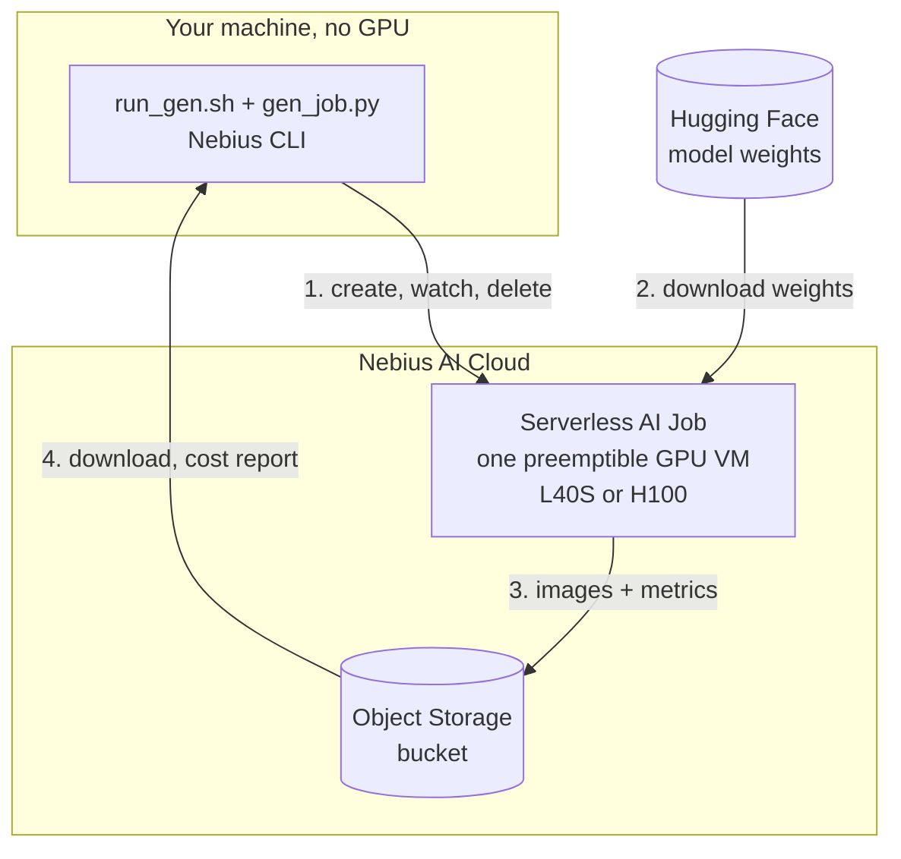
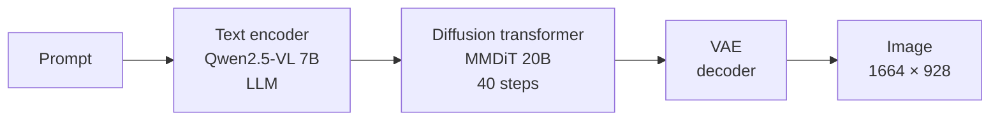
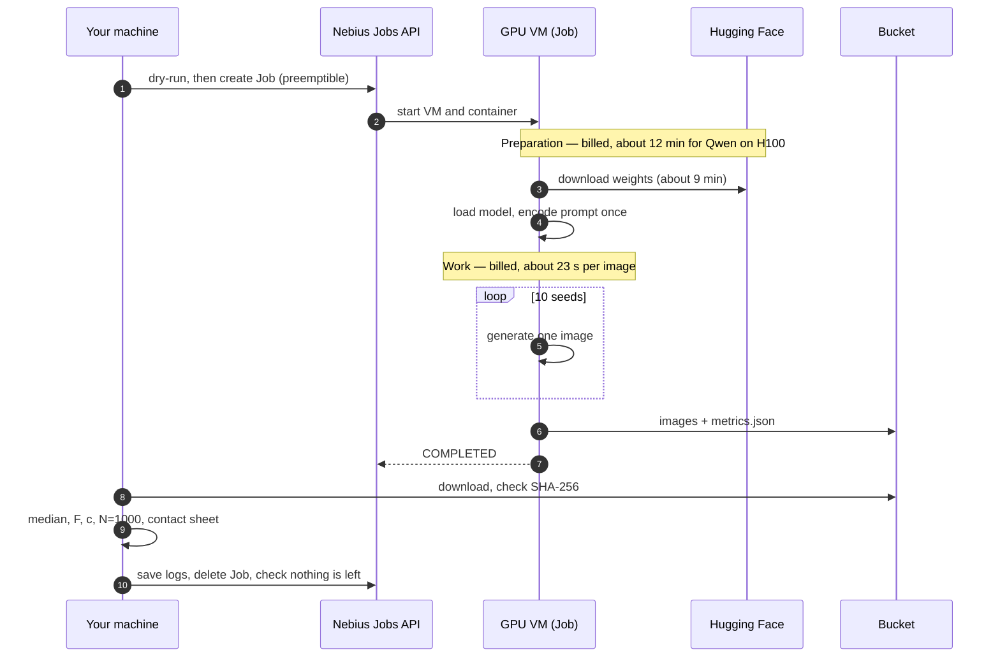
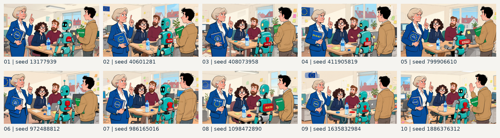
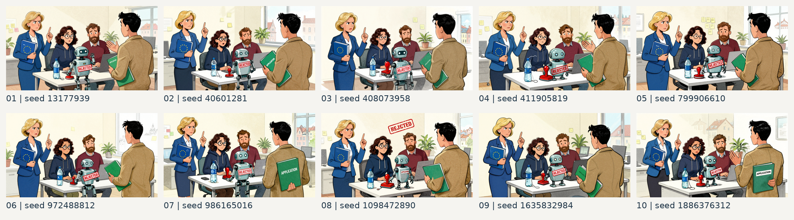
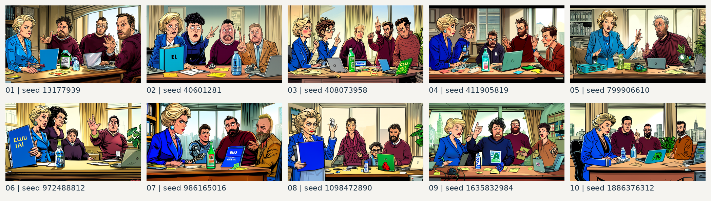

# edu-nebius-media-studio

Text-to-image batches on **Nebius Serverless AI Jobs** with preemptible GPUs, with measured
time and cost per image. Homework 1 of the DataTalksClub course
[Production AI Agents for Generative Media](https://github.com/DataTalksClub/production-ai-agents-for-media-generation) (2026).


*Qwen-Image on a preemptible H100, seed 1098472890 (image 8 of 10 from the submitted run).
All characters are fictional. The robot is supposed to hide the REJECTED stamp behind its back —
in this run it still wears it on the chest.*

## Idea

Legal texts are hard to read, but specialists from other fields often need to understand them.
The idea is to explain difficult parts of regulations as short comics. The first scene: a hiring
team, their AI robot with a REJECTED stamp, a job applicant, and a fictional European Commission
official with the EU AI Act. Here we choose the text-to-image model and the GPU type for it,
by acceptable quality and price.

## Homework 1 answers

Submitted run: Qwen-Image on H100, `qwen-h100-20261121-190946` (10 images, one model load).

| Question | Answer |
|---|---|
| Model | Qwen-Image (`Qwen/Qwen-Image`, revision `75e0b4be`), images 1664×928, 40 steps |
| Modality | Image |
| How it ran | Nebius Serverless AI **Job** |
| GPU | H100 (preemptible, preset `1gpu-16vcpu-200gb`, eu-north1) |
| Generation time per image | **22.86 s** — median of the 10 images (22.83–23.45 s), model already loaded |
| Price per hour the run paid | USD 1.39 per GPU-hour (spot, from Billing) |
| Marginal compute cost per image, c | **USD 0.00883** (work of one image at the paid price) |
| Fixed cost per run, F | USD 0.2829 (preparation: billed run USD 0.3712 − 10 × c) |
| Projected cost per image at N = 1000 | USD 0.00911 (theoretical: one model load) |
| Per-call API for comparison | Replicate `qwen/qwen-image`, **USD 0.025 per output image** ("or 40 images for $1") — [link](https://replicate.com/qwen/qwen-image) |
| Self-host breakeven N | **18 images** = ceil(F / (p − c)) = ceil(0.2829 / (0.025 − 0.00883)) |
| Second API, indirect estimate | fal.ai `fal-ai/qwen-image` lists **USD 0.02 per megapixel**, "rounding up to the nearest megapixel" — [link](https://fal.ai/models/fal-ai/qwen-image). Our 1664×928 image (1.54 MP) would be billed as 2 MP → about USD 0.04 per image, breakeven ceil(0.2829 / (0.04 − 0.00883)) = 10 images. This price is our calculation from fal's rule, not a listed per-image price. |

### Timings of the submitted run

Measured by the worker (`results/runs/qwen-h100/metrics.json`; Job states from the Nebius API):

| Phase | Seconds |
|---|---|
| Startup: Job created → container running (includes about 1 min of queueing that is not billed) | 168.3 |
| Environment: pip install, imports, tokenizer check | 16.8 |
| Model download from Hugging Face (about 57 GB) | 542.8 |
| Model load to GPU: text encoder 3.6 + transformer 7.2 | 10.9 |
| Prompt encoding (once for all images) | 2.0 |
| **Generation of each image**, 1 to 10 | 23.45, 22.83, 22.89, 22.90, 22.93, 22.84, 22.84, 22.85, 22.87, 22.84 |
| Generation: median / total for 10 images | **22.86** / 229.3 |

## Cost per image: self-hosted vs API

Qwen-Image on H100, the submitted run. All self-hosted numbers come from the **Qwen-Image / H100** row of
the [Results](#results) table: preparation F = USD 0.2829 per run, work c = USD 0.0883 / 10 = USD 0.00883
per image, total USD 0.3712.

| Option | USD per image | USD for 1000 images |
|---|---|---|
| Self-hosted, our run of 10 images: (0.2829 + 10 × 0.00883) / 10 = 0.3712 / 10 | **0.03712** | — |
| Self-hosted, 1000 images in one model load (theoretical): 0.2829 / 1000 + 0.00883 | **0.00911** | 9.11 |
| Replicate API `qwen/qwen-image`, listed price | **0.02500** | 25.00 |
| fal.ai API `fal-ai/qwen-image`, indirect estimate (USD 0.02 per megapixel, 1664×928 billed as 2 MP) | about 0.04000 | about 40.00 |

Self-hosting is cheaper than Replicate from **18 images** per run and cheaper than the fal.ai estimate
from 10 images. For a batch of 10 the API is cheaper: we paid USD 0.03712 per image, mostly for
preparation. Comparability: the API price includes everything (no preparation, no idle time), ours is
compute only; Replicate's defaults (30 steps, `go_fast` on) differ from our run (40 steps, CFG 4), and the
image quality of the APIs was not compared.

## Architecture

Three parts: your machine (no GPU) controls the run, Nebius runs one GPU **Job**, and the bucket
keeps the results. The VM exists only while the Job runs.



**Inside the Job: the model.** Qwen-Image is a diffusion model; its prompt is read by an **LLM**
(Qwen2.5-VL) used as the text encoder. The worker encodes the prompt once, frees the LLM, and keeps
only the transformer and the VAE on the GPU, so it also fits a 48 GB L40S. Sana (Gemma 2 encoder)
and Z-Image-Turbo (Qwen3 encoder) follow the same pattern.



## One run, step by step



## Results

All 10 images of each model, without selection (H100 runs, same 10 seeds):

**Qwen-Image** — all five characters and roles right; the stamp is not hidden yet.


**Z-Image-Turbo** — clean, but the 10 images are almost the same.


**Sana** — very fast, but people are mixed up, the robot is often missing, text is broken.


Cost of each run of 10 images, from the Nebius billing export (machine + disk; details in
[results/billing-v02.md](results/billing-v02.md)):

| Model | GPU | Paid USD/h | Preparation: time, USD | Work, 10 images: time, USD | Total USD | USD per image |
|---|---|---|---|---|---|---|
| Sana | L40S | 0.7492 | 4.2 min, 0.0537 | 13.7 s, 0.0028 | 0.0566 | 0.00566 |
| Sana | H100 | 1.09 | 4.3 min, 0.0807 | 6.3 s, 0.0019 | 0.0826 | 0.00826 |
| Z-Image-Turbo | L40S | 0.7492 | 10.8 min, 0.1386 | 62.0 s, 0.0129 | 0.1515 | 0.01515 |
| Z-Image-Turbo | H100 | 1.1607 (1.09 → 1.39) | 7.9 min, 0.1554 | 21.1 s, 0.0068 | 0.1622 | 0.01622 |
| Qwen-Image | L40S | 0.7492 | 20.4 min, 0.2658 | 709.9 s, 0.1477 | 0.4135 | 0.04135 |
| Qwen-Image | H100 | 1.39 | 12.0 min, 0.2829 | 228.6 s, 0.0883 | **0.3712** | 0.03712 |

Work = 10 × median generation time at the paid price; preparation = the rest of the bill (VM start,
packages, weight download, model load, saving, shutdown). Preparation is the larger part of every run.
For Qwen the faster H100 was cheaper even at a spot price of USD 1.39/h; for the small models the
L40S was cheaper. The same mistakes appear on both GPUs: a faster GPU does not make the model smarter.

Per-run measurements: `results/runs/<model>-<gpu>/metrics.json` (every phase, every image, SHA-256)
and `run-summary.json` (computed with the published H100 spot minimum USD 0.79/h at run time —
see the billing file for what was actually paid).

## Cost method

Same definitions in every table, from the billing export:

- paid price P = billed machine cost / billed machine hours (GPU, vCPU and RAM of the preset)
- c = P × median generation seconds / 3600 — cost of one more image once the model is loaded
- work of a run = 10 × c; preparation F = billed cost of the run (machine + disk) − work
- cost per image at N = F / N + c; breakeven against an API price p: N = ceil(F / (p − c)) when p > c

Storage, network, tax and failed runs are not included. N = 1000 is a projection for one model load;
the Job time-out (60 min) and the worker limit (30 images) do not allow it in one Job today, and a
spot price can change during a long run.

## Repository

```
scripts/run_gen.sh              one batch end to end (dry-run, Job, fetch, report, cleanup)
scripts/gen_job.py              Job lifecycle with the Nebius CLI
scripts/gen_bootstrap.sh        container start-up: pinned diffusers/transformers
scripts/qwen_worker.py          Qwen-Image worker (also sana_worker.py, zimage_worker.py)
scripts/review_keyframe_batch.py  timings, F, c, N=1000, contact sheet
scripts/cancel_job.sh           emergency cleanup of one Job
prompts/v02-*.json              run specs: model revision, prompt, seeds, size, steps (one internal
                                note field was removed after the runs, so their SHA-256 differs from
                                spec_sha256 in metrics.json; prompt, seeds and settings are unchanged)
results/                        selected image, contact sheets, billing, per-run metrics
```

The scripts were tidied after the runs (configurable control host, renamed Qwen worker, font fallback);
the generation code, model revisions and settings are the ones used for the results. A dry-run of all
five model/GPU specs from a fresh copy of this repository was accepted by Nebius on 22 Nov 2026.

## How to run

**Prerequisites** (control machine, no GPU needed): a Nebius project with credits,
[Nebius CLI](https://docs.nebius.com/cli/install) logged in, [uv](https://docs.astral.sh/uv/),
Python 3.12, and an Object Storage bucket with an access key, all in region **eu-north1** (the scripts use its
Object Storage endpoint and the GPU platforms `gpu-l40s-a` and `gpu-h100-sxm`)
([quickstart](https://docs.nebius.com/object-storage/quickstart),
[access keys](https://docs.nebius.com/iam/service-accounts/access-keys)).

**One-time setup** — create `config/` in the repository root (it is git-ignored):

```bash
mkdir -p config
# 1. project and bucket (IDs from the Nebius console or CLI)
cat > config/resources.json <<'EOF'
{"project_id": "project-...", "bucket_id": "storagebucket-...", "bucket_name": "your-bucket-name"}
EOF
# 2. subnet for the Job
nebius vpc subnet list --parent-id project-... --format json > config/subnets.json
# 3. container image pinned by digest (pytorch/pytorch:2.13.0-cuda13.0-cudnn9-runtime)
echo '{"digest": "sha256:db80a41f8428644cebcb3d75b0b62df334ab6c0e75785951eb25f48bfbd42407"}' > config/base-image.json
# 4. bucket access key as an AWS-style profile (~/.aws/credentials); default profile name "default"
export S3_PROFILE=default
```

**Run one batch** (from the repository root):

```bash
# validation + Nebius dry-run only: no GPU, no cost
DRYRUN_ONLY=yes bash scripts/run_gen.sh qwen h100 v02-qwen-10-en.json out/qwen-h100
# the paid run: asks for "yes", creates ONE preemptible Job, deletes it at the end
bash scripts/run_gen.sh qwen h100 v02-qwen-10-en.json out/qwen-h100
```

Other models: `sana` with `v02-sana-10-en.json`, `zimage` with `v02-zimage-10-en.json`; GPUs: `l40s`, `h100`.
To run the CLI on another machine, set `CONTROL_HOST=user@host` and `REMOTE_DIR=/path` (that folder
needs `config/`); the scripts and prompts are copied there.

**Cost at the price you paid.** H100 preemptible uses a spot price. After the run, look up the
price in Billing → Usage and recompute the report with it:

```bash
STATE_FILE=config/last-gen-qwen-h100.json PAID_HOURLY_USD=1.39 uv run python scripts/review_keyframe_batch.py
```

The script adds a `paid` scenario to `run-summary.json`. Its c and N = 1000 values equal the tables above
(USD 0.00883 and 0.00911). Its F is USD 0.2860, not 0.2829: the script counts time from Job creation,
including the unbilled queueing, while the tables take F from the bill.

**Cleanup.** `run_gen.sh` deletes its Job on every exit and checks that no Job, Endpoint, VM or
disk is left. If something stays, run `bash scripts/cancel_job.sh <aijob-id>` and check
Billing → Usage the next day. Delete bucket data you no longer need.

## Credits

Built for the DataTalksClub course with Nebius AI Cloud credits. Most of the scripts were written
with AI coding agents (Claude Code and Codex); the decisions were the author's.
Model weights: [Qwen-Image](https://huggingface.co/Qwen/Qwen-Image),
[Z-Image-Turbo](https://huggingface.co/Tongyi-MAI/Z-Image-Turbo),
[Sana](https://huggingface.co/Efficient-Large-Model/Sana_1600M_1024px_diffusers) — under their own licences.

## License

Code: [MIT](LICENSE).
